<div align="center">

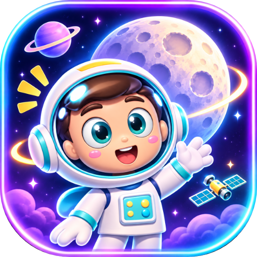

### Learn the Moon by playing it.

Follow Nova the astronaut through animated lessons, a 3D Sun–Earth–Moon simulator, a jump-and-answer quiz, a neon space race and a Moon-drawing studio. English, Bahasa Melayu and 中文. Plays in the browser, on desktop and on Android, online or offline.

**[Play it live](https://lunarcade.lunarcadehub.workers.dev)** · **[Download for Windows, Mac and Android](https://github.com/RextonRZ/lunarcade-hub/releases/latest)**

</div>

---

## Why it exists

Moon phases are one of the first things in science class that a flat textbook diagram explains badly. The Moon is always round, half of it is always lit, and yet every night it looks different. That only clicks once you can see the Sun, Earth and Moon move in three dimensions and look at the Moon from Earth at the same time.

So LunarCade turns the lesson into a hub of four activities. You watch it, you explore it, you prove it in two games, and you draw it yourself. Nova walks you through every step, and a shared leaderboard gives you a reason to come back.

---

## A walk through the game

**The hub.** A low-poly Earth with orbiting satellites and four ways in: Concept, Quiz, Game and Notes. Nova waves from the bottom of the screen and the Galactic Leaderboard is one tap away.
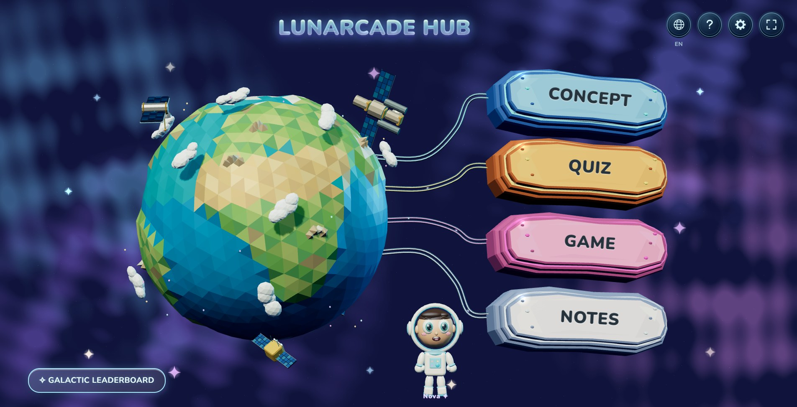

**Concept Lab: the story.** Eight short animated scenes, narrated by Nova, build the idea one piece at a time: the Moon spinning on its own axis, its journey around Earth, and why we always see the same side of it.
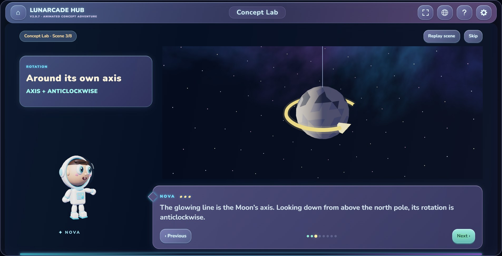

**Concept Lab: the simulator.** Drag to rotate the whole system in 3D and pinch or scroll to zoom. Scrub through the month and watch the visible lit portion, the approximate lunar day and the view from Earth update together, with a lunar calendar of all eight phases alongside.
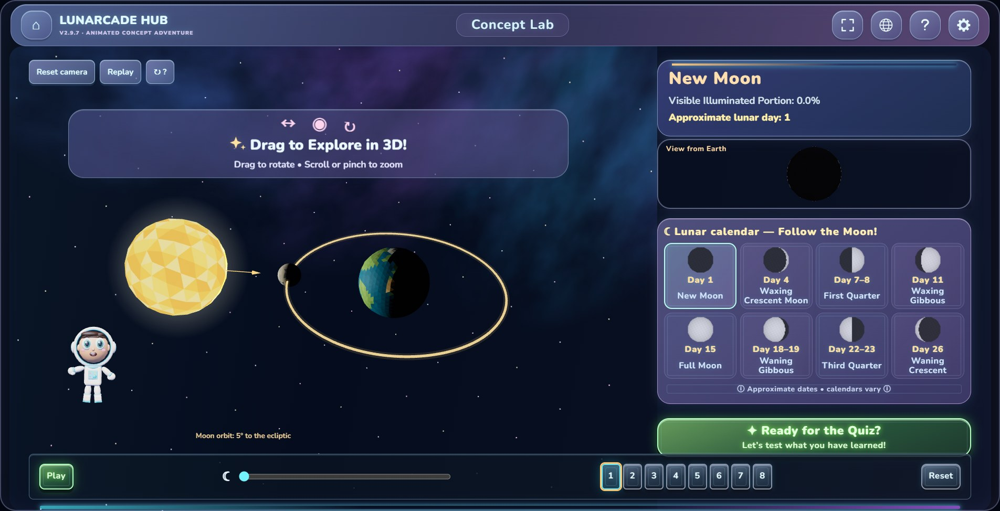

**Astro-Jump Quiz.** A side-scrolling platformer on a crystal-covered asteroid. Pick Standard (8 questions) or Extended (15–20 questions). There is no time limit.
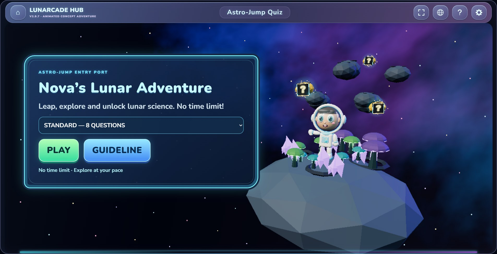

**The rules, up front.** Jump into a gold **?** block to open a question with three answers. A correct answer is worth +100 and crystals +10. A wrong answer costs a life, and the answer stays hidden so you can try again. You get five lives.
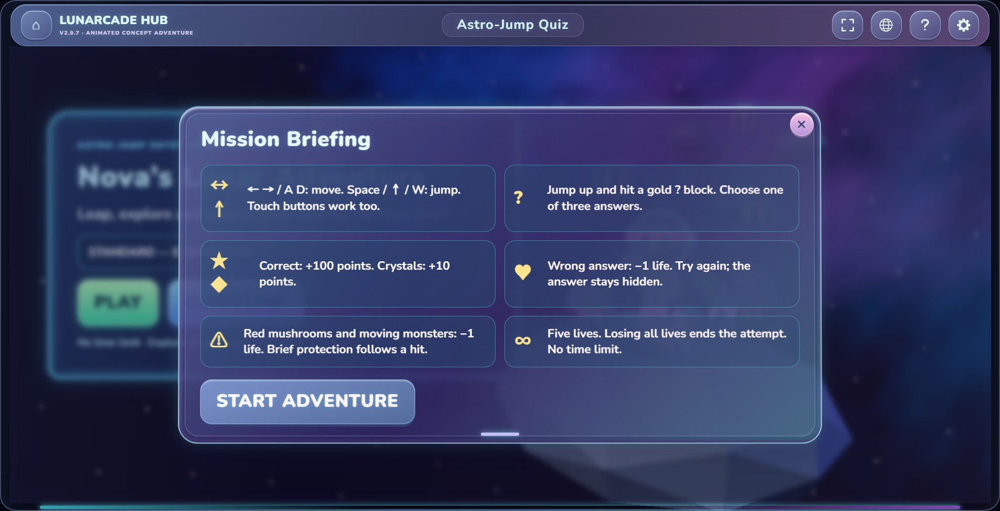

**A nickname, not an account.** Before a run counts for the leaderboard, players pick an explorer name of up to 20 characters. The game asks for a nickname rather than a real name, and nothing else is collected.
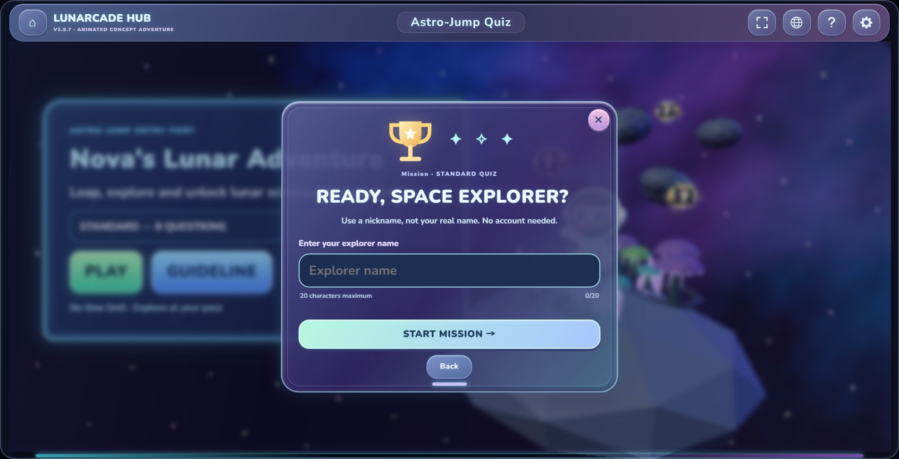

**Jump, explore, answer.** On-screen arrows and a jump button for touch, arrow keys or A/D and Space on a keyboard. Score, lives, crystals and question progress sit along the top.
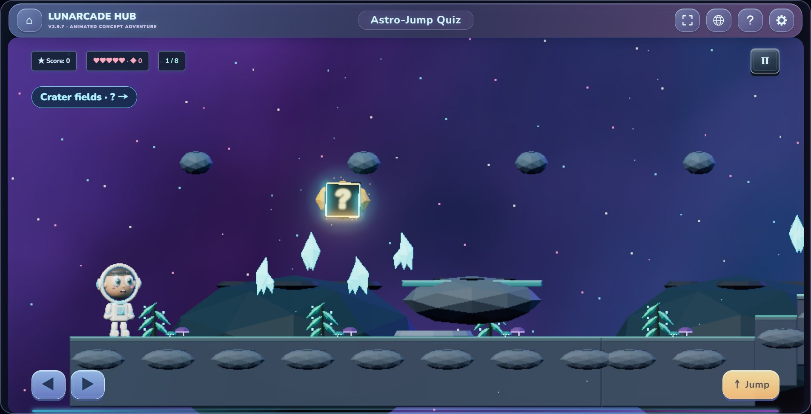

**Galactic Racer.** Your own ship, eight lunar checkpoints and two pilot modes: Thrill Mode or Training Flight. Turn on extra reading time for younger players, or auto acceleration to focus on steering.
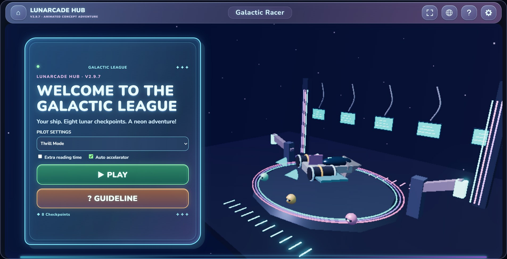

**Read the Moon at speed.** Each checkpoint shows a phase and an approximate day, and you steer through the matching Moon picture. A correct answer earns a 4-second boost. Asteroids, debris and wrong dates each cost one of four ship components, and green repair drones restore them.
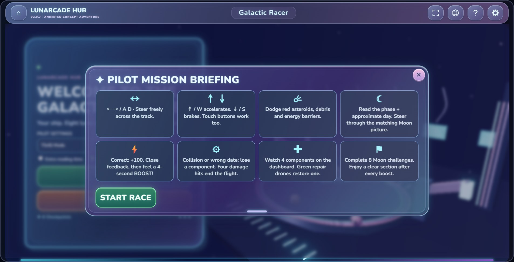

**In the cockpit.** Speed, component health, score, checkpoint progress and flight time on the dashboard, with hazard warnings ahead.
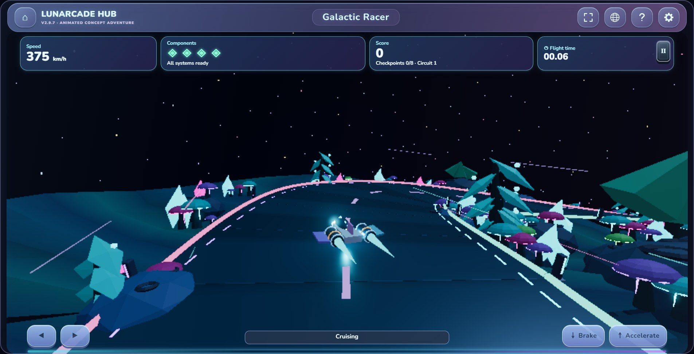

**The Galactic Leaderboard: knowledge.** Quiz rankings for each mission length, ordered by score, then attempt accuracy (retries count), then the earliest result.
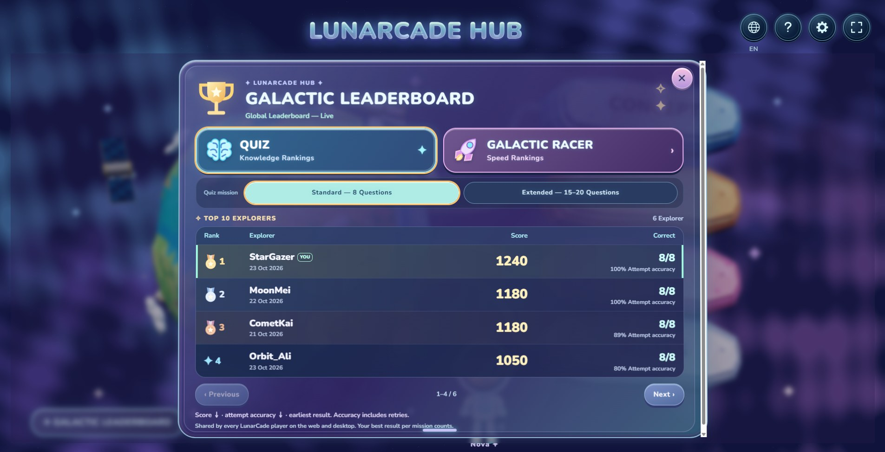

**The Galactic Leaderboard: speed.** Racer rankings for every combination of mode, reading pace and acceleration, ordered by score, then the shortest flight time. Every player on the web, desktop and Android shares the same live board.
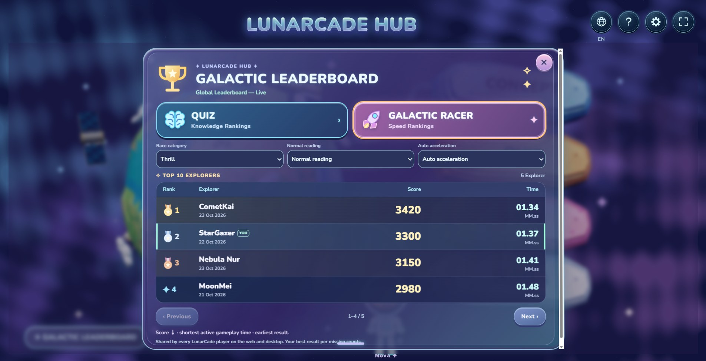

**Interactive Notes.** All eight phases, one at a time: where the Moon sits, what we see from Earth, how much of the disc is lit and roughly which lunar day it is.
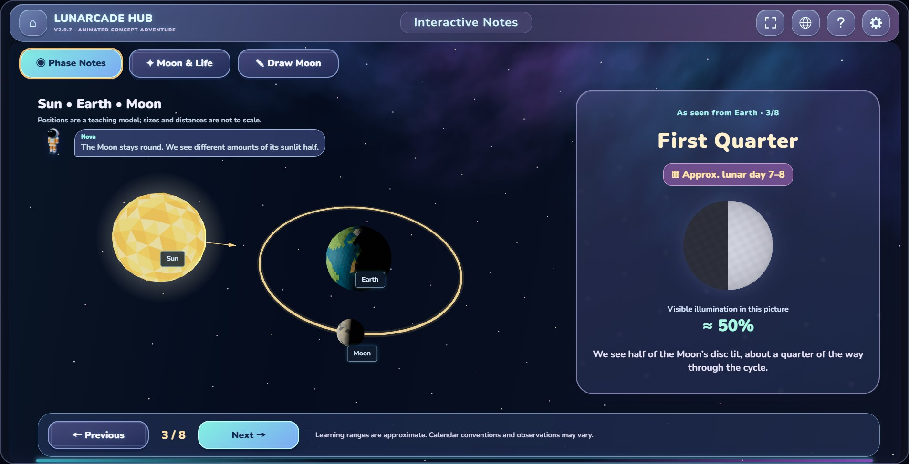

**Draw the Moon.** A drawing mission for each of the eight phases. Paint the lit part with a brush, eraser and adjustable size, then press **Check Drawing** to compare your Moon with the real shape of that phase.
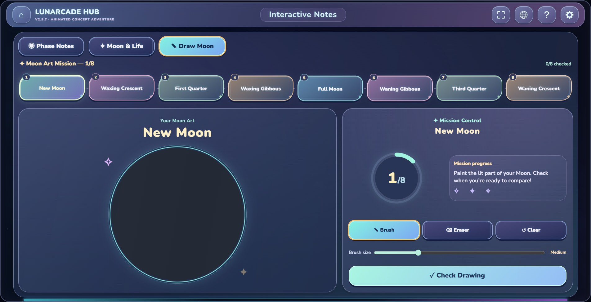

**Sound and accessibility.** Separate switches and volume for background music and sound effects, mute everything, a calm visual mode that tones down motion and effects, full screen, and a reset for all progress.
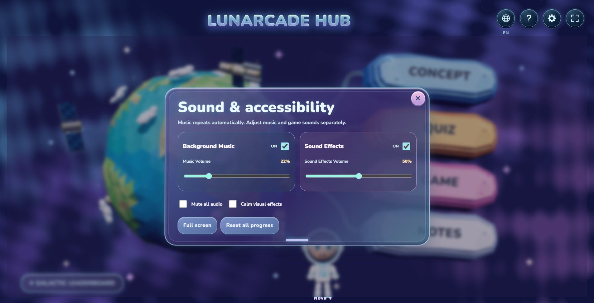

**Three languages, everywhere.** Every screen, lesson and question is available in English, Bahasa Melayu and Simplified Chinese, switchable at any time from the globe button.
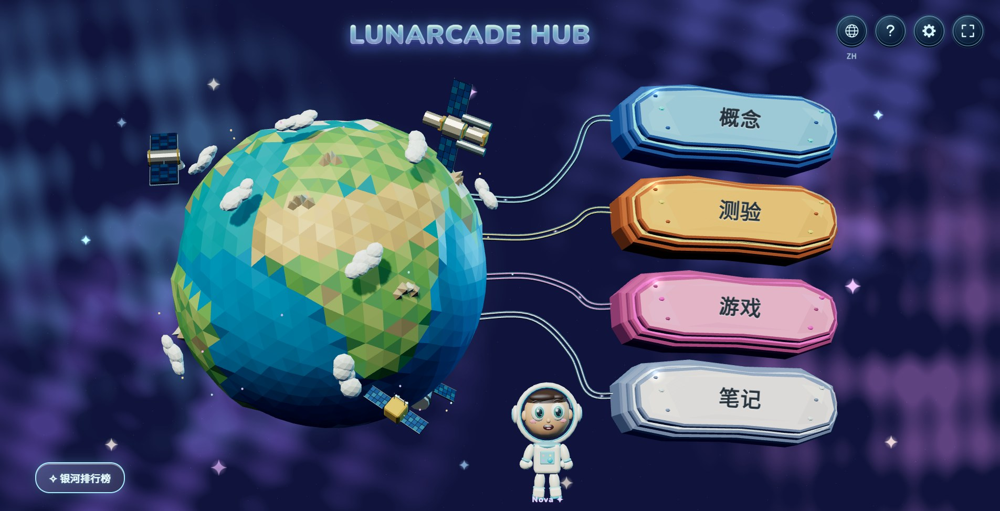
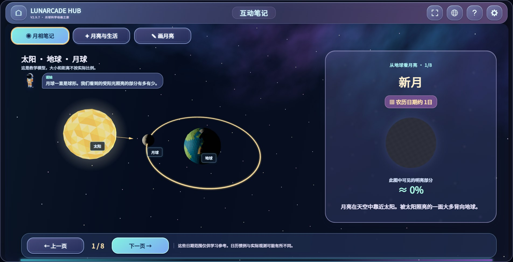

**Opens on every phone, any way up.** The layout is designed for 900 × 520 and up. On smaller screens the whole game scales down to fit, and on a phone held upright it turns sideways like a native landscape game, so it plays even with rotation lock on. The 3D scenes render at a lighter resolution on phones so it stays smooth.
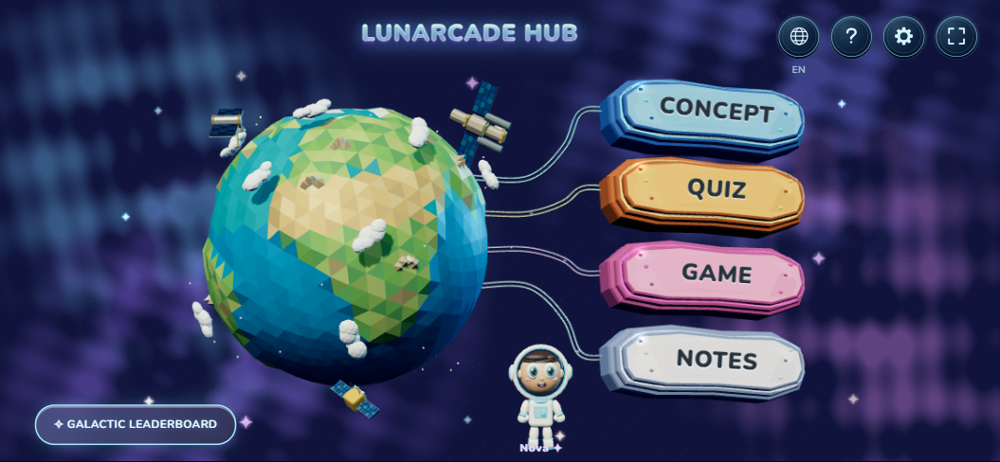

---

## Play anywhere

| Where | How | Offline |
|---|---|---|
| **Browser** | Open the [live site](https://lunarcade.lunarcadehub.workers.dev) | Yes, after the first visit (music and sounds included) |
| **iPhone / iPad** | Safari → Share → **Add to Home Screen** | Yes, after the first visit |
| **Android app** | Install the `.apk` from [Releases](https://github.com/RextonRZ/lunarcade-hub/releases/latest). Always landscape, full screen | Yes, everything is built in |
| **Android browser** | Chrome → **Install app**. The first tap goes full screen and locks landscape | Yes, after the first visit |
| **Windows** | `LunarCade Setup.exe` from [Releases](https://github.com/RextonRZ/lunarcade-hub/releases/latest) | Yes, everything is built in |
| **macOS** | `.dmg` from [Releases](https://github.com/RextonRZ/lunarcade-hub/releases/latest) | Yes, everything is built in |

Offline players keep a local leaderboard on their device. Their best results upload by themselves the next time they are online.

---

## How it works

One set of game files in `web/` ships everywhere. Each platform only adds a thin shell around it.

| Piece | What it does |
|---|---|
| **Game** (`web/`) | The 3D scenes run on Three.js and WebGL. Fonts, music and sound effects are separate files, so a browser only downloads the font subsets and tracks it actually uses. |
| **Leaderboard server** (`worker/`) | A Cloudflare Worker serves the game and a two-endpoint API backed by a D1 (SQLite) database. It keeps each nickname's best run per mission and checks every run the same way the game does. |
| **Online bridge** (`web/js/online-leaderboard.js`) | Merges the server's rankings into the game's own leaderboard, refreshes every 10 seconds while the board is open, and falls back to the local board when there is no connection. |
| **Offline cache** (`web/sw.js`) | A service worker saves the page, code, music and sounds after the first visit. It answers the byte-range requests browsers use for audio, and re-downloads media only when it changes. |
| **Screen fit** (`web/index.html`) | Runs the game in a frame that is always landscape and at least 900 × 520, scaled down to fit the screen and turned sideways on upright phones. The browser maps touches into the turned frame, so the game needs no changes. |
| **Phone tweaks** (`web/js/fit-small-screens.js`) | Caps the render resolution on phones, forwards full screen to the outer page, and locks landscape in mobile browsers on the first tap. |
| **Desktop app** (`desktop/`) | An Electron window around `web/game.html`, never smaller than 900 × 520. It runs offline from the bundled files and talks to the same leaderboard. |
| **Android app** (`android/`) | A Capacitor project, locked to landscape and immersive full screen, with the Nova launcher icon and launch screen. |

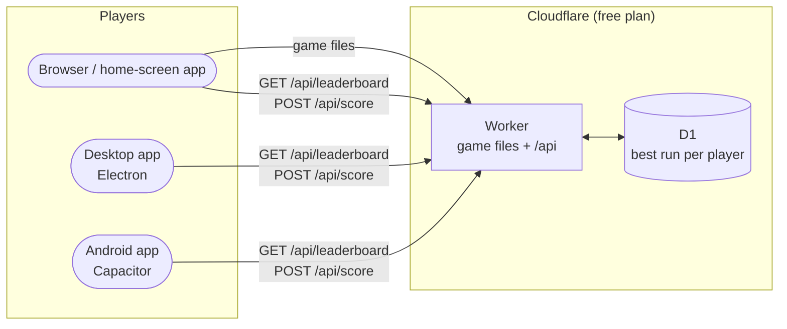

**Leaderboard API**

| Endpoint | Purpose |
|---|---|
| `GET /api/leaderboard` | Top 50 per category: quiz standard/extended, plus every racer mode × reading pace × acceleration |
| `POST /api/score` | Submit a finished run. It is stored only if it beats that nickname's current best for the category |

---

## Getting started

**Prerequisites:** Node.js 20+ · a free [Cloudflare](https://dash.cloudflare.com/sign-up) account for deploying. For Android builds only: Android Studio and JDK 21.

```bash
git clone https://github.com/RextonRZ/lunarcade-hub.git
cd lunarcade-hub
npm install
npm run dev          # game + leaderboard API + local database at http://localhost:8787
```

| Command | What it does |
|---|---|
| `npm run dev` | Run the site and the leaderboard locally, with a local database |
| `npm run desktop` | Open the desktop app |
| `npm run dist` | Build the desktop installer into `dist/` |
| `npm run icons` | Regenerate every web, desktop and Android icon from `art/app-icon.png` |
| `npm run import -- <file>.html` | Import a new single-file game build into `web/` |
| `npx cap sync android` | Copy `web/` into the Android project before an Android build |

---

## Deploy (Cloudflare)

```bash
npx wrangler login
npx wrangler d1 create lunarcade      # paste the printed database_id into wrangler.jsonc
npm run db:setup                      # create the leaderboard table
npm run deploy                        # prints https://lunarcade.<subdomain>.workers.dev
```

Then put the deployed address in `web/js/config.js` as `apiUrl` so the desktop and Android apps join the same leaderboard, and deploy again.

Game files are served as static assets, which are free and unlimited. Leaderboard calls count toward the Workers free plan of 100,000 requests a day. Nothing pauses when the game is quiet.

---

## Releasing the apps

Push a version tag and GitHub Actions builds the Windows installer, the Mac app and the Android APK, then attaches them to a GitHub Release:

```bash
git tag v2.9.7
git push origin v2.9.7
```

Desktop builds are not code-signed yet. Windows shows "Windows protected your PC" (**More info → Run anyway**), and macOS needs right-click → **Open** the first time.

---

## Importing a new game build

The game itself is authored as one self-contained HTML file with every font, sound and script embedded. `npm run import -- LUNARCADE-HUB-Vx.y.z.html` splits it into `web/`:

- embedded fonts become `web/assets/fonts/*.woff2`
- embedded sound effects and music become `web/assets/audio` and `web/assets/music`
- the main script becomes `web/js/app.js`, with the online leaderboard hook added
- the offline cache list in `web/sw.js` is regenerated

Hand-written files (`config.js`, `online-leaderboard.js`, `fit-small-screens.js`) are left untouched. If the importer prints a warning, the leaderboard hook moved in the new build and `tools/import-html.mjs` needs updating.

---

## Project structure

```
web/                 the game as served to players
  index.html                                fits the game to any screen and orientation
  game.html, css/, assets/, js/app.js       generated by `npm run import`
  js/config.js                              leaderboard address for the apps
  js/online-leaderboard.js                  online leaderboard bridge
  js/fit-small-screens.js                   phone render cap, full screen, landscape lock
  manifest.webmanifest, sw.js, icon*.png    installable app + offline cache
worker/              Cloudflare Worker (leaderboard API) and D1 schema
desktop/             Electron main process
android/             Capacitor Android project
art/app-icon.png     source artwork for every icon
tools/               importer, icon generator, Electron launcher
docs/screenshots/    images in this README
```

---

## Tech stack

**Game:** Three.js (WebGL), HTML/CSS/JavaScript, Web Audio.
**Server:** Cloudflare Workers, Cloudflare D1 (SQLite), Workers static assets.
**Apps:** Electron + electron-builder (Windows, macOS), Capacitor (Android), service worker + web app manifest (installable web app).
**CI:** GitHub Actions.

---

## License

MIT. See [LICENSE](LICENSE).

Three.js is MIT licensed. The bundled Nunito, Huninn and Noto Sans SC fonts are licensed under the SIL Open Font License 1.1.
